<picture>
  <source media="(prefers-color-scheme: dark)" srcset="assets/header-dark.svg">
  
</picture>

Software engineer co-op at **Nokia**, building test automation and AI tooling. MS in Computer Science at **Northeastern**, graduating May 2027, and open to full-time roles from 2027.

The work I like best sits in one spot: a model does the first pass, and I build what makes it trustworthy. Grounding, evaluation against ground truth, checks for false passes, and a person at the review gate.

*Stack:* Python, Java, C++, TypeScript, JavaScript, SQL · LLM agents and evaluation, NER, PyTorch, TensorFlow, PySpark, BigQuery · Spring Boot, React, Next.js · GCP, AWS, Azure, Docker, Kubernetes

 

<picture>
  <source media="(prefers-color-scheme: dark)" srcset="assets/nokia-dark.svg">
  
</picture>

*Software Engineer Co-op, Test Automation & AI Tooling · Sunnyvale, CA · May 2026 to now* 
Extending a 50K+ line Python test framework to port routing protocol test suites to a new router platform, on live hardware. I built an LLM agent that automates the porting, grounded in internal docs and a failure checklist mined from past debugging. After live evaluation I rebuilt it into staged, dependency-ordered runs with false-pass checks and human review gates.

<picture>
  <source media="(prefers-color-scheme: dark)" srcset="assets/bitgig-dark.svg">
  
</picture>

*Berkeley × DeepMind Hackathon · September 2026* 
A human-in-the-loop pipeline for lab and medical video, on Cloud Run. Gemini pre-segments the footage into SOP steps, so experts correct drafts instead of raw video, in a review interface I shipped in Next.js, React and TypeScript. [Live demo](https://bitgig-smoky.vercel.app/) · [Code](https://github.com/ZERO34802/BITGIG)

<picture>
  <source media="(prefers-color-scheme: dark)" srcset="assets/nsi-dark.svg">
  
</picture>

*Research Assistant, NIH-funded BioToolKB project · Northeastern University · July 2025 to July 2026* 
A Python pipeline that uses GPT-4.1 to annotate 1M+ biomedical research papers, replacing manual tagging. Extraction accuracy went from 60% to 98% through prompt iteration driven by false-positive and false-negative analysis against ground truth. I also fine-tuned SciBERT for named entity recognition, at 97% F1 on research-tool entities. [NIH project](https://reporter.nih.gov/search/kCp_sb-NWku7rIPfBMI6Xg/project-details/11190944)

<picture>
  <source media="(prefers-color-scheme: dark)" srcset="assets/trybud-dark.svg">
  
</picture>

*Harvard Hack-o-Ween · October 2025* 
A blockchain job-verification platform. Second place and a $3,600 prize at Harvard Hack-o-Ween.

<picture>
  <source media="(prefers-color-scheme: dark)" srcset="assets/msci-dark.svg">
  
</picture>

*Technology Analyst · Mumbai, India · January 2024 to August 2025* 
Migrated 15+ APIs from Azure to GCP on Kubernetes and Docker, cutting latency by 23% and infrastructure cost by 40%. Built Spring Boot REST APIs at 82% test coverage, and Databricks ETL in PySpark that moved 5TB from OracleDB to BigQuery.

<picture>
  <source media="(prefers-color-scheme: dark)" srcset="assets/drone-dark.svg">
  
</picture>

*Research Lead, IEEE AESS funded with a $25,000 grant · July to December 2023* 
A quantized CNN on an NVIDIA Jetson-mounted drone, classifying crop leaves in real time from 15m up, fed by a TensorFlow NDVI pipeline that finds the regions worth looking at. Two IEEE SPACE papers and a patent filing on automated crop health monitoring. [Paper 1](https://ieeexplore.ieee.org/document/10668319) · [Paper 2](https://ieeexplore.ieee.org/document/10667804)

 

<picture>
  <source media="(prefers-color-scheme: dark)" srcset="assets/next-dark.svg">
  
</picture>

*A full-time software engineering role, from 2027* 
[Email](mailto:harshitajogi2001@gmail.com) · [LinkedIn](https://www.linkedin.com/in/harshita-jogi-563227215/) · [Resume](https://harshita-jogi-portfolio.vercel.app/Harshita_Jogi_Resume.pdf)

Off the keyboard, I dance Bharatanatyam, with a Kovida degree from Nalanda Dance Research Center, Mumbai.

The playful version of all this is an island you can walk around: **[harshita-jogi-portfolio.vercel.app](https://harshita-jogi-portfolio.vercel.app)**
